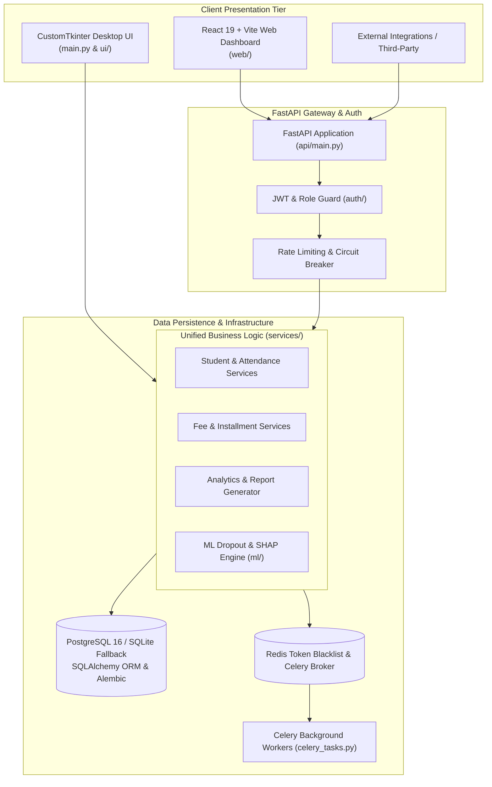

# Binary Brain Institute Management System (BB-IMS)

[](https://github.com/themanoj-025/Institute-Management-System/actions)
[](./LICENSE)
[](https://www.python.org/)
[](https://fastapi.tiangolo.com/)
[](https://react.dev/)
[](tests/)

Comprehensive educational institute management platform designed for academies,
coaching centers, and vocational training institutes. Unifies a CustomTkinter
desktop application, React 19 web SPA, and high-performance FastAPI microservice
backed by an ML-driven student dropout risk engine with TreeSHAP explainability.

---

## Quick Facts

| Dimension | Details |
| --- | --- |
| **Domain** | Academic ERP, Student Information System & Predictive Dropout Analytics |
| **Core Architecture** | Shared Service Layer + CustomTkinter Desktop + React 19 SPA + FastAPI v1 |
| **Database** | PostgreSQL 16 (production) with seamless offline SQLite fallback |
| **Predictive ML** | Gradient-boosted student dropout risk classifier with TreeSHAP attribution cards |
| **Background Tasks** | Celery task queues with Redis broker (auto-fallback to synchronous dispatch) |
| **Security & Auth** | JWT with unique JTI, Redis token blacklist, bcrypt cost 14, role-based guards |
| **Test Coverage** | 463 collected tests across 45 unit, security, integration, and ML suites |
| **License** | [MIT License](./LICENSE) |

---

## Table of Contents

- [What It Does](#what-it-does)
- [Screenshots](#screenshots)
- [Three Unified Interfaces](#three-unified-interfaces)
- [Key Features](#key-features)
- [Architecture](#architecture)
- [Machine Learning & Explainability](#machine-learning--explainability)
- [Tech Stack](#tech-stack)
- [Prerequisites](#prerequisites)
- [Quick Start](#quick-start)
- [Configuration](#configuration)
- [Project Structure](#project-structure)
- [API Reference](#api-reference)
- [Testing](#testing)
- [Limitations](#limitations)
- [Contributing](#contributing)
- [Security](#security)
- [License](#license)

---

## What It Does

Educational institutions frequently wrestle with fragmented systems: attendance
is taken on paper or offline spreadsheets, fees are tracked in standalone accounting
software, and students slipping toward dropout remain unnoticed until it is too late.

**Binary Brain IMS** solves this by providing a unified administrative hub:
1. **Full Student Lifecycle:** Tracks admissions, biometric/manual attendance,
   course enrollments, exam grading, fee installments, and career placement.
2. **Predictive Dropout Prevention:** Uses historical attendance, fee compliance,
   and grade trajectories to flag at-risk students before critical attrition points.
3. **Transparent Decision Support:** Generates TreeSHAP feature attribution cards
   explaining exactly why an individual student was marked at risk.
4. **Three Native Interfaces:** Allows administrators and staff to work via an
   offline-capable desktop app, a modern web dashboard, or automated REST integrations.
5. **Robust Audit & Governance:** Logs every administrative activity, enforces
   strict Role-Based Access Control (RBAC), and monitors data drift with PSI metrics.

---

## Screenshots

<!-- TODO[L2-01]: Add desktop client and React 19 web dashboard screenshots from running instances -->
> *CustomTkinter desktop client with global search, React 19 web dashboard, and student dropout risk cards.*

---

## Three Unified Interfaces

All three clients interface directly with the same underlying `services/` layer,
eliminating discrepancies between desktop and web operations:

| Interface | Technology | Target Users | Key Capabilities |
| --- | --- | --- | --- |
| **Desktop Client** | CustomTkinter + CTkMessagebox | Front-desk staff, offline operators | Full offline SQLite capability, keyboard shortcuts (`Ctrl+K` search), native dialogs |
| **Web Dashboard** | React 19 + Vite + Tailwind | Remote administrators, instructors | Real-time analytics, responsive mobile layouts, dark/light theme switching |
| **REST API** | FastAPI v1 + OpenAPI | External integrations, automated scripts | 50+ REST endpoints, Swagger `/docs`, rate-limited endpoints, JWT bearer auth |

---

## Key Features

- **Automated Timetabling & Attendance:** Auto-generates course schedules and
  records daily staff and student attendance with monthly compliance aggregation.
- **Fee Installment Management:** Issues receipts, tracks partial payments, calculates
  overdue penalties, and generates exportable PDF statements via ReportLab.
- **TreeSHAP Risk Cards:** Identifies key risk drivers (e.g., sudden attendance drop,
  unpaid dues, declining test marks) with visual impact scores.
- **Data Drift Monitoring:** Employs Population Stability Index (PSI) and
  Kolmogorov-Smirnov (KS) tests to alert staff when incoming student cohorts diverge from training baselines.
- **Hardened Security Architecture:** Implements Redis-backed token revocation,
  per-IP rate limiting, IDOR defenses, SQL injection prevention, and strict parameter typing.

---

## Architecture



### Architectural Highlights

- **Shared Domain Services:** Business rules reside in `services/` rather than
  API route handlers or GUI view classes, ensuring 100% logic reusability.
- **Dual Persistence Strategy:** Runs seamlessly against PostgreSQL for multi-user
  production deployments or local SQLite for single-workstation offline use.
- **Graceful Task Degradation:** The task dispatcher resolves to Celery in production
  environments and cleanly falls back to in-process synchronous execution in dev/test.

---

## Machine Learning & Explainability

The dropout prediction pipeline analyzes operational indicators across three core axes:

```text
Student Indicators (Attendance %, Unpaid Fees, Grade Trend)
    ├── Feature Pipeline (ml/features.py)
    ├── Gradient Boosted Model (ml/train.py)
    ├── Probability Calibration (ml/eval_metrics.py)
    └── TreeSHAP Explainer (ml/explain.py)
         └── Output: Risk Level (High/Med/Low) + Top Contributory Features
```

Model drift is actively tracked in `ml/drift_psi.py`. If student population characteristics
drift by a PSI score $> 0.25$, an automated warning recommends model retraining.

---

## Tech Stack

| Component | Library / Framework | Version | Purpose |
| --- | --- | --- | --- |
| **Language** | Python | `>=3.10` | Core backend runtime |
| **Desktop UI** | CustomTkinter | `>=5.2.0` | Modern themed desktop interface |
| **Web Frontend** | React & Vite | `19.x` | High-performance SPA dashboard |
| **REST Framework** | FastAPI & Uvicorn | `>=0.143.0` | Asynchronous REST service |
| **ORM & Migrations** | SQLAlchemy & Alembic | `2.x` | Database persistence and schema revisions |
| **Machine Learning** | scikit-learn, XGBoost, SHAP | Latest | Dropout classification & TreeSHAP attributions |
| **Task Queue** | Celery & Redis | Latest | Asynchronous background report generation |
| **Reporting & Export** | ReportLab & OpenPyXL | Latest | PDF fee receipts and Excel audit exports |
| **Auth & Crypto** | PyJWT & bcrypt | Latest | Cryptographic authentication & password hashing |

---

## Prerequisites

- **Python 3.10+** (Python 3.11 recommended)
- **Node.js 18+** (for building the React web dashboard)
- **PostgreSQL 16** (or SQLite for local single-user testing)
- Optional: **Redis** (for production token blacklisting and Celery queues)

---

## Quick Start

### 1. Clone & Set Up Python Environment

```bash
git clone https://github.com/themanoj-025/Institute-Management-System.git
cd Institute-Management-System
```

#### Windows (PowerShell)

```powershell
python -m venv .venv
.venv\Scripts\Activate.ps1
pip install -r requirements.lock
Copy-Item .env.example .env
```

#### Linux / macOS

```bash
python3 -m venv .venv
source .venv/bin/activate
pip install -r requirements.lock
cp .env.example .env
```

### 2. Launch the Desktop Client (Offline Mode)

```bash
python main.py
```

*The CustomTkinter interface boots immediately, creating a local `database/bb_ims.db` if uninitialized.*

### 3. Launch the FastAPI Microservice

```bash
uvicorn api.main:app --host 0.0.0.0 --port 8000 --reload
```

*Expected output:*
```text
INFO:     Started server process
INFO:     Waiting for application startup.
INFO:     Database tables initialized successfully.
INFO:     Application startup complete.
INFO:     Uvicorn running on http://0.0.0.0:8000 (Press CTRL+C to quit)
```

Interactive OpenAPI Swagger documentation is accessible at [http://localhost:8000/docs](http://localhost:8000/docs).

### 4. Launch the React Web Dashboard

```bash
cd web
npm install
npm run dev
```

The web dashboard will be available at [http://localhost:5173](http://localhost:5173).

---

## Configuration

All environment variables can be specified in `.env` or injected at runtime:

| Variable | Default | Secret? | Description |
| --- | --- | --- | --- |
| `SECRET_KEY` | `""` | Yes | **Required**: 32-byte hexadecimal cryptographic key |
| `DATABASE_URL` | `postgresql+psycopg2://...` | Yes | Target database connection string |
| `DB_PATH` | `database/bb_ims.db` | No | Local SQLite file path when PostgreSQL is unset |
| `REDIS_URL` | `redis://localhost:6379/0` | No | Redis connection URI for blacklists and caching |
| `USE_CELERY` | `auto` | No | Toggle Celery execution (`true`, `false`, `auto`) |
| `BCRYPT_COST` | `14` | No | Hashing work factor for user credentials |
| `API_PORT` | `8000` | No | Port binding for the FastAPI server |
| `JWT_EXPIRE_HOURS` | `24` | No | Validity duration for access bearer tokens |
| `SMTP_HOST` | `smtp.gmail.com` | No | Mail server hostname for notices and resets |
| `SMTP_PASSWORD` | `""` | Yes | Application password for SMTP authentication |

---

## Project Structure

```text
Institute-Management-System/
├── api/                        # FastAPI REST service
│   ├── main.py                 # Application factory and middleware
│   ├── routes/                 # admin, auth, courses, fees, students, etc.
│   └── schemas.py              # Pydantic request and response models
├── auth/                       # Authentication and authorization guards
│   ├── jwt_handler.py          # Token issuance, decoding, and verification
│   └── session.py              # User session tracking state
├── database/                   # Database layer
│   ├── db_session.py           # Engine creation and session factories
│   ├── models.py               # SQLAlchemy ORM entity models
│   └── seeder.py               # Initial seed data generator
├── ml/                         # Machine learning and explainability
│   ├── drift_psi.py            # Population Stability Index monitoring
│   ├── explain.py              # TreeSHAP feature attribution generator
│   ├── service.py              # High-level dropout prediction service
│   └── train.py                # Model training and calibration pipeline
├── services/                   # Shared domain service layer
│   ├── activity_service.py     # System audit and logging services
│   ├── fee_service.py          # Payments, installments, and receipts
│   └── student_service.py      # Student records, enrollments, attendance
├── ui/                         # CustomTkinter desktop interface components
│   ├── sidebar.py              # Navigation sidebar widget
│   └── theme_manager.py        # Light and dark visual appearance manager
├── web/                        # React 19 + Vite web application
├── tests/                      # Pytest suite (463 unit and integration tests)
├── main.py                     # Desktop GUI launch entrypoint
├── celery_app.py               # Celery application instance
├── docker-compose.yml          # Full-stack container orchestration
├── pyproject.toml              # Build settings and tool configurations
└── README.md
```

---

## API Reference

| Method | Endpoint | Role | Description |
| --- | --- | --- | --- |
| `POST` | `/api/v1/auth/login` | Public | Authenticate user and issue JWT token pair |
| `POST` | `/api/v1/auth/logout` | Authenticated | Revoke active token into Redis blacklist |
| `GET` | `/api/v1/students` | Staff / Admin | Paginated list of registered students with filters |
| `POST` | `/api/v1/students` | Admin | Register new student profile and enrollment |
| `GET` | `/api/v1/fees/pending` | Staff / Admin | List overdue student fee installments |
| `POST` | `/api/v1/fees/pay` | Staff / Admin | Record payment and generate receipt reference |
| `GET` | `/api/v1/analytics/kpis` | Admin | High-level enrollment, revenue, and attendance KPIs |
| `POST` | `/api/v1/ml/predict-dropout` | Staff / Admin | Calculate dropout probability with TreeSHAP breakdown |

---

## Testing

The test suite covers database migrations, domain services, security constraints,
IDOR prevention, API endpoints, rate limiting, and ML model drift.

```bash
# Run all tests
pytest tests/ -v -o addopts=""

# Run with test coverage
pytest tests/ --cov=services -o addopts=""
```

All external services (Redis, SMTP, external databases) are automatically
mocked or run in isolated temporary SQLite test sessions during test runs.

---

## Limitations

- **GUI Platform Dependencies:** The CustomTkinter desktop client requires an
  active display server (X11/Wayland on Linux, Windows Desktop, or macOS Quartz);
  headless servers should run the FastAPI and Web SPA tiers.
- **Biometric Hardware Integration:** Biometric attendance relies on standard
  CSV/API imports; direct hardware SDK bindings require custom device drivers.
- **Model Training Scale:** The baseline dropout model is calibrated on synthetic
  and standard institutional benchmarks; large universities should retrain with
  local historical graduation datasets using `python -m ml.train`.

---

## Contributing

Contributions are welcome! Please follow these guidelines:

1. Fork the repository.
2. Create your branch: `git checkout -b feat/new-feature`.
3. Format and lint code: `ruff check .` and `black .`.
4. Ensure all tests pass: `pytest tests/ -o addopts=""`.
5. Submit a pull request to `main`.

See [CONTRIBUTING.md](./CONTRIBUTING.md) for complete contribution policies.

---

## Security

Please report vulnerabilities privately via GitHub Security Advisories or by
contacting the repository administrators. Never commit production secrets or
active credentials. See [SECURITY.md](./SECURITY.md) for full policy.

---

## License

This project is licensed under the [MIT License](./LICENSE).
